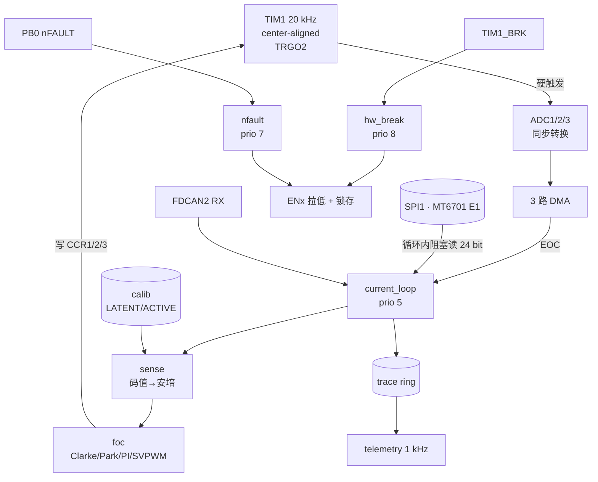

# mit-motor 固件架构（草稿 v0.1）

> 状态：草稿。硬件事实已按 PCB14 网表核对，标「待实测」的条目尚未上板验证。
> 相关：硬件引脚与约束见本文 §2；参考实现清单见 [reference-implementations.md](reference-implementations.md)；两轮调研的结论见 [research-findings.md](research-findings.md)。

## 1. 范围

做：单关节驱动器的固件——三相 PWM、低边电流采样、FOC 电流环、MT6701 角度、CAN FD 指令、三相电流的相对增益自校准与冻结、故障安全。

不做：无感控制、弱磁/MTPA、参数辨识、双编码器故障检测、CANopen、bootloader/OTA、热模型。

## 2. 硬件事实

### 2.1 引脚（PCB14 网表 + G491RET6 LQFP64 手册核对）

| 功能 | 引脚 | 网名 | 外设 |
|---|---|---|---|
| PWM A/B/C | PA8(42) / PA9(43) / PA10(44) | PWM_AH / PWM_BH / PWM_CH | TIM1_CH1/CH2/CH3 |
| EN A/B/C | PA7(21) / PB14(36) / PB15(37) | PWM_AL / PWM_BL / PWM_CL | GPIO 推挽输出 |
| SOA / SOB / SOC | PA2(14) / PC4(22) / PB1(25) | SOA_F / SOB_F / SOC_F | ADC1_IN3 / ADC2_IN5 / ADC3_IN1 |
| TIM1_BKIN | PA6(20) | BKIN | 比较器 TLV7021（过压）|
| nFAULT | PB0(24) | NFAULT | EXTI，开漏 + 10 kΩ 上拉 |
| nSLEEP | PC5(23) | NSLEEP | GPIO（内部 1 MΩ 下拉）|
| SPI1 | PB3(56) SCK / PB4(57) MISO | — | 两片 MT6701 共用 |
| 编码器片选 | PB5(58) / PB6(59) | ENC1_CS / ENC2_CS | GPIO |
| FDCAN2 | PB13(35) TX / PB12(34) RX | — | TCAN1044（S 脚 10 kΩ 下拉，常开）|
| USART3 | PB10(30) TX / PB11(33) RX | — | CN3（GH1.25-3P）|
| USB FS | PA11(45) DM / PA12(46) DP | — | Type-C，CC 5.1 kΩ 下拉（仅 device）|
| 母线电压 | PA3(17) | VBUS_ADC | ADC1_IN4，100 k/8.06 k → 13.4:1 |
| NTC | PC0(8) | ADC12_IN6 | ADC1_IN6 |
| HSE | PF0(5) / PF1(6) | OSC_IN / OSC_OUT | 16 MHz |
| 调试探针 | PC6(38) / PC7(39) / PC8(40) | — | 预留 strobe（§9）|

空闲可用：PC9(41)、PA15(51)、PC10–PC12(52–54)、PD2(55)、PB7(60)、PB9(62)、PA4(18)、PA5(19)、PB2(26)。

### 2.2 MP6540HGU-A-Z 的行为

BOM 实发 **MP6540HGU-A-Z**（H 版，不是 HA 版）：

- pin 6/7/8 = **PWMA/B/C**，pin 3/4/5 = **ENA/B/C**。原理图把后者命名成 `PWM_AL/BL/CL`，**名字有误导性，代码里一律叫 `EN_A/B/C`**。
- SOx 是**双向电流输出**：典型比例 1/9200（范围 1/10500…1/7800），1 A 相电流对应约 114 µA。
- 板上 R7/R8 = 2 kΩ/2 kΩ 分压偏置 → 静态 1.65 V，戴维南阻抗 1 kΩ。于是

  $$V_{SO} = 1.65 + \frac{I_{ph}}{9200}\times 1\,\text{k}\Omega \approx 1.65 + 0.109\,I_{ph}$$

- 12 bit @ 3.3 V → **7.4 mA/LSB**；±3 A 只用到满量程的 10%。
- 待实测：EN 拉低是否使该相彻底高阻（手册只说 "enable pin"，推定为关断）。

### 2.3 采样链

- 三个 SOx 落在 **三个独立 ADC** 上，TIM1_TRGO2 单次触发三路同时转换，无采样时刻偏斜。
- 前端 100 Ω + 100 pF：$\tau \approx 110\,\text{ns}$，12 bit 建立需约 1 µs → 采样时间取 92.5 个 ADC 周期（ADC 时钟 60 MHz 下约 1.5 µs）。
- 有效采样窗口 = **三相低边同时导通的零矢量时刻**（center-aligned、计数器回零）。
- VREF+ 接 3V3（TL431 的 2.5 V 只喂比较器）→ 绝对精度受 LDO 支配；相对增益标定不受影响。

### 2.4 硬件安全路径

- 过压：TLV7021 比较 `VBUS` 分压（100 k/9.76 k）与 2.5 V 基准，翻转点**按阻值计算约 28.1 V**（待实测），输出经 1 kΩ 直连 **TIM1_BKIN**，硬件关断 PWM。
- 驱动芯片故障：nFAULT 开漏 → PB0，需要软件响应。
- 注意：**BKIN 只把 PWM 拉到无效电平，对 H 版芯片等于低边常通（刹车）**。要自由停车必须同时把 ENx 拉低。这条决定了 §8 的故障动作顺序。

## 3. 运行时

**RTIC 2.4**，理由：固定优先级抢占、静态资源、无分配器、编译期检查的共享访问。

未决：关键路径之外用裸寄存器还是 embassy async。两条都有实证——`gulitsky/reactance` 用 RTIC + `stm32g4` PAC 跑通整机 FOC；`qff233/FOC`、`okhsunrog/oxifoc` 用 embassy。因为 USB 上位机是硬需求，最可能的形态是**混合**：TIM1/ADC/DMA/strobe 裸寄存器，USB/CAN/UART 用 embassy async + 最低优先级任务里的 executor。定稿前不影响 `motor-core` 的开发。

## 4. crate 划分

```
crates/
  motor-core/    纯算法：foc、sense、calib、svpwm、pid   ← host 可测，不 import 任何 PAC
  motor-icd/     消息契约：CAN 帧、USB 帧、遥测记录格式  ← 无依赖
  motor-hw/      G491 绑定：TIM1、ADC1/2/3、DMA、SPI1、FDCAN2、GPIO
  firmware/      RTIC 应用：任务、优先级、状态机装配
tools/
  replay/        标定数据回放与消融分析（Python，不入固件）
```

约束：`motor-core` 与 `motor-icd` 里出现 `embassy_stm32` / `stm32g4` / `#![no_std]` 之外的平台假设即为违规；它们必须能在 x86 上 `cargo test`。

## 5. 任务与优先级

| RTIC 优先级 | 任务 | 绑定 | 周期 | 预算 |
|---|---|---|---|---|
| 8 | `hw_break` | TIM1_BRK | 异步 | < 2 µs：EN 拉低、MOE=0、锁存 |
| 7 | `nfault` | EXTI PB0 | 异步 | < 2 µs：同上，标记驱动故障 |
| 5 | `current_loop` | ADC DMA 完成 | 50 µs | < 25 µs（含编码器 4.8 µs）|
| 4 | `can_rx` | FDCAN2_IT0 | 帧驱动 | < 10 µs |
| 2 | `aux_encoder` | 软件定时 | 1 ms | < 10 µs（第二片 MT6701）|
| 2 | `telemetry` | USART3 / USB | 1 ms | 剩余预算 |
| 1 | `calib` | 软件定时 | 10 ms | 剩余预算 |

时间基准：HSE 16 MHz → PLL（M=4, N=85, R=2）→ **170 MHz**，需开 boost 模式。20 kHz center-aligned → `ARR = 4250`，50 µs = 8500 周期。

## 6. 数据流



## 7. 标定子系统

目标：零和约束 $\sum i_k = 0$ 下辨识三路相对增益，并保证辨识结果可信。

- 参数**双缓冲**：`latent`（可写、不生效）/ `active`（只读、控制环使用）。切换必须显式提交。
- 估计器状态机：`Idle → Collecting → Converged → (Frozen) / (LatchedFault)`。
- 更新放行条件（全部满足才更新 latent）：
  1. 采样窗口有效（占空比低于上限、无故障）
  2. 激励足够（|i| 超过阈值、方向覆盖达到设定）
  3. 跨工况一致（同一组增益在多个幅值/方向扇区的估计值互相在容差内）
  4. 未处于 `Frozen` / `LatchedFault`

  **为什么第 3 条不是「残差」**：三路同构采样 + 零和约束下，每个样本有 3 个观测、2 个独立方程、2 个未知相对增益，**恰好定解**，残差恒为零。可信性只能来自时间与工况多样性，不能来自被估计量自身的残差。残差只保留一个用途：突发跳变的即时检测。
- 记录要求：估计值按工况分组保存（幅值、方向扇区、占空比、温度），供事后一致性检验；遥测同时记录 dq 域的二次谐波分量（增益失配的直接观测）。
- 主基线：零和约束下的递推最小二乘（RLS）。对照：工装一次性离线标定、仅零点标定。
- 估计器是 `motor-core` 里的纯逻辑，输入 `(raw[3], 状态)`，输出 `(latent_gain, 置信标志)`，可在 host 上用录制的数据重放。

## 8. 安全与故障

| 故障 | 检测 | 动作顺序 |
|---|---|---|
| 母线过压 | TLV7021 → BKIN（硬件）| 硬件关 PWM → ISR：**先拉低 ENx**，再锁存、置零指令 |
| 驱动 nFAULT | PB0 EXTI | ENx 拉低 → MOE=0 → 锁存 → CAN 报错帧 |
| 母线欠压 | ADC 均值低于阈值 + 去抖 | 限流 → 低于下限则关断 |
| 采样窗口无效 | 占空比或时序判据 | 跳过本周期采样，**冻结标定更新**，控制按上一拍外推 |
| 零和残差超限 | 连续 N 周期超门限 | 冻结 → 诊断 → 锁存 |
| NTC 过温 | ADC1_IN6 | 降额 → 超过上限关断 |

故障锁存后只有显式复位路径可以清除（CAN 命令 + 无故障条件持续满足一段时间）。

**顺序是硬要求**：`EN` 拉低必须先于任何软件状态更新，因为 PWM=0 在 H 版芯片上是刹车不是停机。

## 9. 调试与测量

三个 strobe 引脚（DSLogic 用来量 ns 级时序，示波器用来判形状，均不参与控制）：

| 引脚 | 事件 |
|---|---|
| PC6 | ADC 触发点 / 采样窗口起点 |
| PC7 | `current_loop` 入口 → 出口 |
| PC8 | 标定状态更新 |

台架模式（与正常 FOC 互斥）：`EN_A=1`、`PWM_A=0` 使 A 相低边常通，外部电源经负载与 10 mΩ 分流器注入，万用表 200 mV 档读分流电压作为参考，逐相、逐电流点、双向记录 `(相, 设定值, 参考读数, ADC 原始码, NTC)`。

## 10. 未决

1. 裸 PAC vs 混合 embassy——等仓库与文献调研汇总后定。
2. CAN 帧约定（ID、MIT 帧布局、是否加调试帧）。
3. 占空比上限的具体数值（受采样窗口与 1.5 µs 采样时间约束）。
4. EN 拉低是否真高阻（上板实测）。
5. OVP 翻转点实测值。
6. 是否引入直流母线电流作为独立观测量：现有 PCB14 没有母线分流器，若引入需改板；这是「可信判据要不要第二个观测通道」的硬件级问题。
